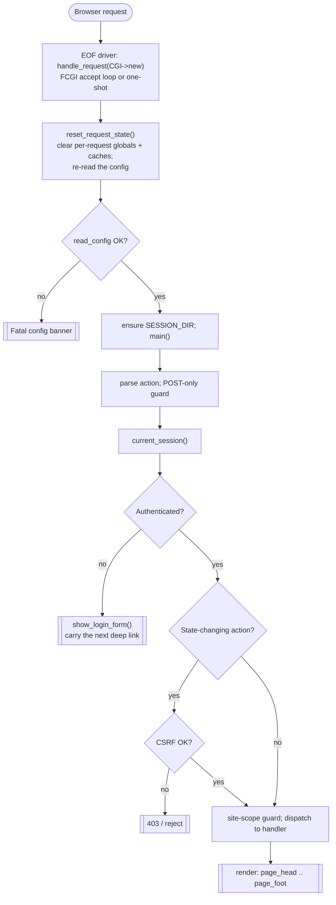
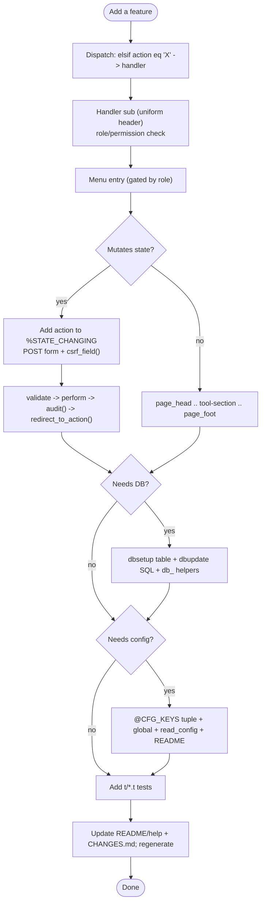

# fetchconfig-web -- Technical / Developer Documentation

**Audience:** engineers extending or maintaining fetchconfig-web.
**Scope:** architecture, request lifecycle, data structures, the PostgreSQL
schema, the security model, and step-by-step recipes for adding functionality.
**Version:** this document tracks fetchconfig-web 2.08 (requires fetchconfig
9.72+).

---

## 1. What the application is

fetchconfig-web is a **single-file Perl CGI/FastCGI application**
(`fetchconfig-web.cgi`) that provides a browser UI in front of the command-line
tool **fetchconfig** (a network-device configuration backup engine). It lets
operators browse per-device backups, view/compare/download configurations,
trigger on-demand backups, edit the fetchconfig device table, manage users and
site-based access, and read audit and status information.

**It is deliberately one file.** All Perl logic, the HTML generation, and the
client-side JavaScript live in `fetchconfig-web.cgi`. The stylesheet was
externalised in 2.00 to `fetchconfig-web.css` (served statically, cacheable).
Static assets (CSS, fonts, images, help/documentation HTML) live under a
web-served directory; see section 9.

### Source-of-truth boundaries (important mental model)

| Data | Owner / source of truth | fetchconfig-web's role |
|---|---|---|
| Device table (flat file) | fetchconfig CLI + the web editor | reads/parses on demand; writes via the editor |
| Device backups (files on disk) | fetchconfig CLI | reads only (view/compare/download) |
| Users, sites, audit, sessions metadata | **PostgreSQL** (this app owns it) | full read/write |
| Configuration | `/etc/fetchconfig-web.cfg` | re-read on every request; never written |

The web app **never** owns the device table or the backups -- fetchconfig does.
Treat the flat file and the backup tree as external inputs.

---

## 2. Runtime model: CGI and FastCGI

The script runs under either plain CGI or FastCGI (mod_fcgid). A global
`$RUN_MODE` records which. Under FastCGI the process is long-lived and serves
many requests in a loop, so **per-request state must be reset between
requests** or data leaks from one user's request into the next.

### The request loop

* The **last lines of the file** are the entry point. Under FastCGI an
  `FCGI::Request` accept loop calls `handle_request(CGI->new)` once per accepted
  request; under plain CGI a single `handle_request(CGI->new)` runs and the
  process exits.
* `handle_request($q)` owns one request. It assigns `$cgi = $q`, calls
  `reset_request_state()` (on an error string it shows the misconfiguration via
  `show_login_form()` and returns), ensures `$SESSION_DIR` exists, then calls
  `main()`.
* `reset_request_state()` runs at the start of every request. It clears the
  request-scoped globals (the warning flags `$SECURITY_WARNING` /
  `$AUDIT_WARNING` / `$EXTERNAL_CHANGE_NOTICE`, the memoization caches
  `$_sites_cache`, `%_user_sites_cache`, `$_allowed_dirs_cache`,
  `$_templates_t_cache`, `$_template_used_cache`, `$_fatal_error_cache`, plus
  `_syntax_cache_reset()`), then **re-reads the config file** and returns
  `read_config()`'s error string, if any. It does *not* clear `$cgi` --
  `handle_request()` assigns that fresh per request. **If you add a
  request-scoped cache or global, you MUST clear it here.**
* `main()` is the **dispatcher**: it reads `action`, enforces the POST-only
  guard, resolves the session, runs the CSRF and site-scope guards, then runs
  the `if/elsif` dispatch chain.

### Why the driver sits at the very end of the file

Several large data tables (`%COMMON_OPTS`, `%MODEL_CATALOG`, `%EMAIL_OPTS`,
`$SECRET_KEEP`, the base64 logo/icon blobs) are built with run-time `my`
assignments scattered through the file. The `handle_request(CGI->new)` calls are
on the **last lines** so all of those have executed before `main()` dispatches
anything. Do not move the driver earlier.

---

## 3. File / code layout (sections)

The `.cgi` is organised top-to-bottom into labelled sections:

1. **Module imports** -- `use strict; use warnings;` then the `use` list
   (CGI, CGI::Cookie, DBI, MIME::Base64, File::Path, Algorithm::Diff, etc.;
   FCGI and Crypt::Bcrypt are optional and loaded defensively). `DBD::Pg` is
   never `use`d -- DBI loads it implicitly from the `dbi:Pg` DSN -- and
   `Digest::SHA` is `require`d lazily at its two call sites
   (`_reset_token_hash`, `_sha256_file`).
2. **Constants** -- all `use constant` (version, min-fetchconfig, login-throttle
   windows, reset-token TTL, bcrypt cost, audit page size, the masking banner).
3. **Config-file handling** -- `@CFG_KEYS` registry, `parse_config_file`,
   `read_config`, validators.
4. **CGI / FastCGI request core** -- request-scoped globals, `reset_request_state`,
   `handle_request`, `main` (the driver is at EOF, per section 2).
5. **Functions** -- everything else (auth, DB access, rendering, editors,
   tools), each with a uniform 80-`#` header block.

Every `sub` carries a header of the form:

```perl
################################################################################
# name
#
# <description>
#
# Parameters:
#   $arg1   ...
################################################################################
sub name { ... }
```

Match this format when adding functions.

---

## 4. Request lifecycle (the dispatch path)

```
browser request
   -> handle_request(CGI->new)     (EOF: FCGI accept loop or one-shot)
      -> $cgi = $q
      -> reset_request_state()     (clear per-request globals/caches, then
                                    re-read the config; fatal banner if broken)
      -> ensure $SESSION_DIR exists
      -> main()
          1. $action = $cgi->param('action') || '' (sanitised)
          2. POST-only guard for %STATE_CHANGING actions -> 405
          3. pre-auth actions (login, logout, forgot/reset) branch out here
          4. current_session()  -> ($sid, $username, $csrf, $pw_warn) or ()
          5. unauthenticated?  -> show_login_form(...) with the "next" deep link
          6. CSRF check for state-changing actions (see section 7.4)
          7. per-device site-scope guard
          8. dispatch:  if ($action eq 'X') { handler($user) } elsif ...
```

The same flow as a diagram:



```text
 [Browser request]
        |
        v
 handle_request(CGI->new)   EOF driver: FCGI accept loop or one-shot
        |
        v
 reset_request_state()      clear per-request globals + caches;
        |                   re-read the config
        v
   read_config OK? --no--> [[ Fatal config banner ]]
        | yes
        v
 ensure SESSION_DIR; main()
        |
        v
 parse action; POST-only guard
        |
        v
 current_session()
        |
        v
  Authenticated? --no--> [[ show_login_form (carry "next" deep link) ]]
        | yes
        v
  State-changing action? --no--------------------+
        | yes                                     |
        v                                         |
  CSRF OK? --no--> [[ 403 / reject ]]             |
        | yes                                     |
        v                                         v
  site-scope guard; dispatch to handler  <--------+
        |
        v
  [[ render: page_head .. page_foot ]]
```

The dispatch is a long `if/elsif` chain on `$action` (~100 actions). Each branch
calls a handler sub. **Read-only** actions (`view_report`, `status`, `compare`,
...) render directly. **State-changing** actions (`login`, `user_save`,
`add_site`, `note_save`, `backup_now`, ...) are in `%STATE_CHANGING` and are
CSRF-protected and POST-guarded.

### The `%STATE_CHANGING` set

A hash (`map { $_ => 1 } qw(...)`) listing every action that mutates state. The
CSRF gate and POST-only guard consult it. **Any new mutating action MUST be
added to this set** or it will be rejected (or, worse, left unprotected). Tests
assert membership (see `FCWebTest::state_changing_actions`).

---

## 5. Configuration subsystem

### 5.1 The config registry (`@CFG_KEYS`)

All settings are declared in one array of tuples:

```perl
[ 'KEY_NAME', 'type', 'default-or-(required)', 'human value hint', $min, $max ]
```

* `type` drives validation. The full set is `bool`, `enum`, `file`, `int`,
  `path`, `path_opt`, `siteurl`, `str`, `str_req`, `url`. (`enum_onoff` and
  `secret` are *device-table* option types from `%COMMON_OPTS` -- see section
  6 -- not config types.)
* `$min`/`$max` bound integer types.
* `(required)` means no default; `read_config` fails loudly if it is missing.

`read_config()` parses `/etc/fetchconfig-web.cfg` (via `parse_config_file`),
validates each value against its registry entry, applies defaults, and assigns
the file-scoped `my $KEY` globals. Validation errors surface as a configuration
error on the login page; a bad file does not crash the process.

**To add a config key:** add one `@CFG_KEYS` tuple, declare the `my $KEY`
global in the top declaration block, assign it in `read_config`, and document it
in README.md (a test asserts every registry key is documented). Provide a safe
default; only use `(required)` for things with no reasonable default.

### 5.2 Web paths (2.00+)

`WEB_DIR` (filesystem root for static assets, presence-checks only), `BASE_URL`
(URL root the browser uses), and the sub-paths `CSS_BASE_URL` / `FONT_BASE_URL`
/ `IMAGE_BASE_URL` / `JS_BASE_URL` / `HELP_BASE_URL`. The stylesheet must exist at
`<WEB_DIR><CSS_BASE_URL>/fetchconfig-web.css` or every page shows a red
"directories not configured" banner. `HELP_BASE_URL` (2.03+, default `/help`) is
the help tree: `help.html` plus the `fetchconfig-web/` and `fetchconfig/`
sub-directories that `help_scan_dir()` scans to build the two "additional help"
menus (label from each file's `<title>`, capped at `HELP_MAX_FILES`).

`JS_BASE_URL` (2.08+, default `/js`) holds `mermaid.min.js`, the self-contained
Mermaid renderer bundled in the release's `js/` directory. It powers the
**Template viewer state-machine diagram** (`show_view_template`), which is a
server/client split: `template_mermaid_source()` loads fetchconfig's own
`fetchconfig::model::GenericTemplateParser` by absolute path from
`FETCHCONFIG_PATH` -- eval-guarded and `require`-idempotent, exactly like
`fetchconfig_installed_version()` loads `Constants.pm`, and never copied into the
app -- then the gloss/`mermaid` subs ported verbatim from the engine tool
`gen-template-docs.pl` (`tdiag_action_gloss` / `tdiag_trigger_gloss` /
`tdiag_edge_label` / `tdiag_mm_label` / `tdiag_target_of` / `tdiag_mermaid`)
emit the `stateDiagram-v2` source. The browser renders it with
`<JS_BASE_URL>/mermaid.min.js`, pulled in only on that page, using the IBM Plex
Sans webfont (`FONT_BASE_URL`, needed so labels fit) via an inline scoped
`@font-face` -- no shared CSS change, so no cache-bust. The source is
HTML-escaped into `<pre class="mermaid">` (and `tdiag_mm_label` strips Mermaid
metacharacters), so a template cannot inject markup. Missing parser, missing
`mermaid.min.js`, a missing font, or a template that does not parse each yield a
short note rather than a (possibly stale) diagram.

---

## 6. Data structures (in-memory)

| Structure | Kind | Purpose |
|---|---|---|
| `@CFG_KEYS` | array of tuples | config registry (section 5.1) |
| `%CFG_OBSOLETE` | hash | keys that were removed; flagged if still present |
| `%COMMON_OPTS` | hash of `{type,mandatory}` | device-table options available on every model (incl. the universal `debug`) |
| `%MODEL_CATALOG` | hash: model -> `{option => {type,mandatory}}` | per-model editor option sets, built from `%COMMON_OPTS` + extras |
| `%EMAIL_OPTS` | hash | option set for the device-table `email:` directive |
| `$SECRET_KEEP` | scalar | placeholder token shown in the editor for an unchanged masked secret |
| `%STATE_CHANGING` | set | CSRF/POST-guarded actions (section 4) |
| `%AUDIT_SECRET_KEY` | set | field names whose values are redacted in the audit log |
| `%LOGIN_LANDING` | set | action names that are valid post-login redirect targets |
| `%TOOL_TITLE` | hash | Tools sub-page -> title |
| request-scoped globals | scalars | `$cgi`, warning flags, memo caches -- reset each request |

### Device-table option entry shape

Each option is `{ type => '<validator>', mandatory => 0|1 }`. `type` selects an
input widget and a validator (`secret` -> masked field with show toggle,
`enum_onoff` -> on/off, `path` -> allow-listed directory, `int`, `enum_site`,
`debug`, ...). The parsed device table and the catalog together drive the
editor UI and the save-time validation (`cfg_value_problem`).

---

## 7. Security model

Security is layered; the important mechanisms:

### 7.1 Authentication and password storage

* Passwords are hashed with **bcrypt** (`Crypt::Bcrypt`, cost `BCRYPT_COST`=12)
  when available; `bcrypt_available()` probes the build at runtime (AIX-safe).
* The per-password **salt** comes from `secure_random_bytes()` which reads
  `/dev/urandom`, loops on short reads, and **dies rather than falling back to
  `rand()`** (fail-closed). Session IDs and reset tokens use the same source.
* A **constant-time** path guards login against user-enumeration timing: a
  nonexistent user is still compared against a cached dummy hash
  (`dummy_password_hash`, memoised in a closure).

### 7.2 Sessions

* Server-side, file-based. A session file lives at `$SESSION_DIR/$sid` where
  `$sid` is 48 hex chars (24 random bytes). `$SESSION_DIR` is created `0700`.
* File format: five lines -- `username`, `expiry` (epoch), `csrf` token,
  `pw_warn` flag, `login_time` (epoch). The 5th line is fixed for the life of
  the session and drives the `SESSION_MAX_LIFETIME` cap; the idle slide
  rewrites lines 1-4 but preserves it. Legacy four-line files (written before
  the cap) are still accepted and get a `login_time` on first load.
  `load_session` validates the sid shape before touching disk.
* Two expiries: idle `SESSION_TTL` (slides) and absolute `SESSION_MAX_LIFETIME`
  (hard cap from login). Password change/reset invalidates sessions.
* Cookie: `HttpOnly`; `Secure` is added when `HTTPS_ENABLED=1`; `SameSite` set.

### 7.3 CSRF protection

* Each session has a CSRF token (`csrf_token()`); forms emit it via
  `csrf_field()` (a hidden `csrf` input).
* `csrf_ok()` checks the submitted token for every state-changing action. Login
  and logout are handled specially (login has no session yet).

### 7.4 Request hardening

* State-changing actions are **POST-only** and **CSRF-checked** (the
  `%STATE_CHANGING` set).
* **Login/reset throttling**: `login_attempts` (keyed by IP and by username)
  with a failure window (`LOGIN_WINDOW_SECS`) and cooldown
  (`LOGIN_COOLDOWN_SECS`); `LOGIN_MAX_FAILURES` trips the throttle. Designed to
  avoid both a timing oracle and FastCGI-worker exhaustion.
* **Password policy**: length bounds and per-class minimums
  (`PASSWORD_MIN_*`, `PASSWORD_MIN_CLASSES`); a new password must differ from
  the default and from the username.
* **HSTS** header when HTTPS; `Cache-Control: no-store` on dynamic pages.

### 7.5 Authorization (roles + site scoping)

* Rights are per-user boolean columns: `edit_device_table`, `admin_function`,
  `download_full_report`, `download_full_config`. `PROTECTED_USER` is the
  built-in super-admin that cannot be deleted or de-admined.
* **Site scoping**: a device's `site=` tag restricts which users see it. A
  site-limited user only sees/edits devices tagged with their assigned sites
  (`user_sites`). Enforcement is centralised in `read_device_ids()` /
  `user_site_access()`.

### 7.6 Config view masking

* The config view is **always masked** (`mask_secrets`); an unmasked copy is
  gated behind the per-user `download_full_config` right and is audited.
* `mask_secrets` redacts secrets in config text: Cisco `secret|password <type>
  <hash>` (universal), SNMP community, RADIUS/TACACS keys, WPA passphrases,
  Aruba CX controller/auth-server keys, bare indented `key` lines, etc. Masking
  runs **before** syntax highlighting, so the highlighter never sees cleartext.
* `valid_report_name` / `template_path_ok` / the directory allow-lists
  (`read_allowed_dirs`) prevent path traversal for report/template/file access.

### 7.7 Privilege separation

* "Backup Now" and every template-directory mutation can run via `sudo`
  (`USE_SUDO_FOR_BACKUP_NOW`, `TEMPLATE_HELPER`) so the web user itself needs no
  write access to the repository/templates. The sudo command is built in one
  place per operation with fixed arguments.
* The template helper `fetchconfig-web-install-template.pl` (**v1.7**) is the
  single privileged helper, run through `sudo`. Its subcommands:
  * **Templates** (`.tmpl`): `install` (save, keeps one `.bak`), `install-new`
    (atomic create-if-absent, used by template upload and by the HEX generator's
    final install), `revert`, `delete` (template + `.bak`), and `rename` (atomic,
    refuse-if-exists, moves the `.bak`). Each is wrapped by a CGI function
    (`save_template`, `install_new_template`, `delete_template_file`,
    `rename_template_file`) that falls back to a direct filesystem op when no helper
    is configured and the directory is web-writable.
  * **Debug logs** (`.debug`, v1.5): `read-debug <file> [offset] [length]` and
    `delete-debug <file>` -- fetchconfig writes these as root, mode 0600, so the
    viewer/delete go through the helper (`debug_log_window`, `do_delete_debug`).
  * **Schedule** (v1.6): `list-cron <user>` -- a read-only `crontab -l` for
    `CRON_USER`, used by `cron_list_raw` for Tools -> Show schedule, because the
    cron spool directory is root-owned. The user is validated and must exist
    (`getpwnam`); nothing is ever written. v1.7 forces `LC_ALL=C` (so
    `cron_list_raw`'s "no crontab" match works on a non-English Linux host) and
    resolves `crontab` by absolute path under a sane `PATH`.
  Helper-failure output is condensed to one line by `helper_fail_msg` /
  `helper_error_summary` (so an out-of-date helper's `--help` dump is never shown),
  with a redeploy hint when a subcommand is unrecognised. A new subcommand needs
  **no sudoers change** -- the grant is on the script path -- only a redeploy.
* The HEX uploader runs `<FETCHCONFIG_PATH>/tools/generate_template.pl` **directly**
  (not via sudo) with `-f <hex> -o <out>`, reads the draft template from the `-o`
  file, stamps `syntax_style`, then installs it through the helper like any upload.
  The input is validated first (`hex_looks_like_record_session`, 1 MB cap).
* SQL is always parameterized (DBI placeholders). The one place a column name is
  interpolated (`db_set_user_flag`) uses a fixed allow-list.

### 7.8 Audit logging

* `audit(%args)` appends a row to `audit_log` for every security-relevant event
  (login success/failure/throttle, user/site/permission changes, config view,
  external device-table change, errors, ...).
* Secret field values are redacted via `%AUDIT_SECRET_KEY`.
* An **external-change tripwire** detects when the device table was modified
  outside the app (compares a stored token; records owner + mtime) and warns on
  the next page / editor open.
* Audit-write failure raises an operational (amber) warning rather than
  silently losing the event.

---

## 8. Database (PostgreSQL)

The app owns a PostgreSQL schema created by `fetchconfig-web-dbsetup.pl`.
Upgrades ship as `fetchconfig-web-dbupdate-<ver>.sql`. All access is via DBI
with a fresh connection per request (no pooling); every query is parameterized.

### 8.1 Tables

**users** -- the account store.

| Column | Type | Notes |
|---|---|---|
| username | TEXT PK | login name |
| pass_hash | TEXT NOT NULL | bcrypt (or legacy) hash |
| edit_device_table | BOOLEAN | right: edit the device table |
| admin_function | BOOLEAN | right: admin (tools, users, audit) |
| download_full_report | BOOLEAN | right: unmasked report download |
| download_full_config | BOOLEAN | right: unmasked config download |
| email | TEXT | notification/reset address (nullable) |

**sites** -- the site codes used for device scoping.

| Column | Type | Notes |
|---|---|---|
| id | INTEGER PK | numeric id (id 0 is the reserved "any site": code `*` = `SITE_ALL_CODE`, seeded with description "All sites") |
| code | TEXT UNIQUE NOT NULL | the `site=` tag value |
| description | TEXT NOT NULL DEFAULT '' | human label |

**user_sites** -- which sites a user may see (many-to-many).

| Column | Type | Notes |
|---|---|---|
| username | TEXT FK -> users ON DELETE CASCADE | |
| site_id | INTEGER FK -> sites ON DELETE RESTRICT | |
| | PRIMARY KEY (username, site_id) | |

**audit_log** -- append-only event log.

| Column | Type | Notes |
|---|---|---|
| id | BIGINT PK (sequence) | monotonic id |
| ts | TIMESTAMPTZ DEFAULT now() | event time |
| username | TEXT | actor (nullable) |
| ip | TEXT | client IP |
| action | TEXT NOT NULL | event type (e.g. `login`, `user_save`) |
| object_type | TEXT | e.g. `user`, `table`, `site` |
| object_id | TEXT | the affected object |
| field | TEXT | changed field (for granular edits) |
| old_value / new_value | TEXT | before/after (secrets redacted) |
| detail | TEXT | free-text context |

Indexed on `ts`, `username`, `action`, `object_id`.

**app_state** -- small key/value store for cross-request state.

| Column | Type | Notes |
|---|---|---|
| key | TEXT PK | e.g. `device_table_token`, `external_notice:<user>` |
| value | TEXT | |
| username | TEXT | who last wrote it |
| ts | TIMESTAMPTZ | |

The web user has UPDATE but not DELETE here, so one-shot notices are "cleared"
by emptying the value.

**login_attempts** -- throttle counters.

| Column | Type | Notes |
|---|---|---|
| kind | TEXT | `ip` or `user` |
| keyval | TEXT | the IP or username |
| failures | INTEGER | count in the current window |
| last_fail | TIMESTAMPTZ | last failure time |
| | PRIMARY KEY (kind, keyval) | |

**password_resets** -- one-shot reset tokens.

| Column | Type | Notes |
|---|---|---|
| token_hash | TEXT PK | SHA-256 of the token (the token itself is never stored) |
| username | TEXT NOT NULL | target account |
| created / expires | TIMESTAMPTZ | TTL from `RESET_TOKEN_TTL` |
| used | BOOLEAN | single-use flag |

**device_notes** -- per-device free-text notes.

| Column | Type | Notes |
|---|---|---|
| note_id | INTEGER PK (sequence) | |
| device_id | TEXT, UNIQUE index | one note per device |
| note | TEXT | |
| keep | BOOLEAN | "pin" so an orphaned-notes cleanup leaves it |
| created / updated | TIMESTAMPTZ | |

### 8.2 Connection and grants

`db_connect()` opens a DBI handle (`RaiseError=0`, `AutoCommit=1`) and returns
`undef` on failure (callers show a "server misconfiguration" message rather than
leaking details). The setup script grants the web user the minimal privileges
(no DELETE on `app_state`, etc.). There is no ORM; queries are inline DBI.

### 8.3 Schema changes

Add a `CREATE TABLE`/`ALTER` to `fetchconfig-web-dbsetup.pl` (idempotent --
check existence first, as the existing blocks do) **and** ship a
`fetchconfig-web-dbupdate-<newver>.sql` for existing installs. Add the access
helpers (`db_*`) next to the related ones, parameterized.

---

## 9. Static assets, rendering, and the UI

* **HTML** is generated in Perl (`print qq{...}`), not templated. `page_head()`
  emits the `<head>` (linking the external stylesheet with a
  `?v=<APP_VERSION_INTERNAL>` cache-buster -- the true shipped version, so new
  CSS is always picked up; never the config-overridable `APP_VERSION`), the
  title bar, the menu, and any warning banners; `page_foot()` closes the page.
* **CSS** is the external `fetchconfig-web.css` (served from `WEB_DIR`). The only
  inline CSS left in the CGI is the dynamic login backdrop (depends on login
  state) and `style="display:none"` toggle targets for JS; email HTML uses
  inline styles by necessity.
* **Sections/boxes**: content panels use `.tool-section` (green) or
  `.tool-section-blue`; the title bar is `.tool-section-title`. Long pages get a
  floating Top/Bottom nav (`top_bottom_nav()`).
* **Syntax highlighting** of configs is done by per-scheme `highlight_*`
  functions, selected by `highlight_config()` after masking.
* **Debug log rendering** (`highlight_debug_log()`, `debug_log_transcript()`)
  is registered in `%SYNTAX_HIGHLIGHTERS` under the pseudo-model `__debug__`,
  the same way the template viewer uses `__template__`. It is not in
  `template_syntax_schemes()`, so it is never user-selectable. Three things
  about it are load-bearing and easy to break:
  - **The hex field is positional, not tokenised.** A `Net::Telnet` `dump_log`
    line is `<dir> 0x%05x: ` followed by exactly `16*3 + 4` characters of hex
    (`DEBUG_HEX_WIDTH`) and then the ASCII gutter. `_dbg_hex_line()` measures
    that field **relative to the end of the offset match**, never from a fixed
    column, because the offset widens past 1 MB. Both the hex view and the
    transcript go through that one function; keep it that way.
  - **Each line's newline goes INSIDE its `<span>`.** The Sent-only /
    Received-only filter is CSS `display:none` on whole lines; with the
    newline outside the span, a filtered view would be a column of blank rows.
    `t/D1-debug-viewer.t` asserts `\n(?!</span>)` never matches.
  - **`user_may_read_debug` deliberately breaks the sibling pattern.** The
    other per-user right accessors open with
    `return 1 if user_is_unrestricted($dbh, $username)`, and
    `user_is_unrestricted` means "not limited to any site", NOT "admin". That
    would hand debug logs -- and so device passwords -- to every non-admin
    account with no site restriction. It is admin OR the explicit flag, never
    implied. Do not align it with the others.
  - **The size bands are enforced in three places** and must agree:
    `show_debug_log` refuses over `DEBUG_MAX_BYTES`, `do_download_debug`
    re-checks the same ceiling server-side (the greyed button is only UI), and
    `debug_log_read` splits anything over `DEBUG_VIEW_FULL_MAX` into two
    `DEBUG_VIEW_CHUNK` pieces. The cut marker is *composed* between two
    independently highlighted chunks, never parsed out of the content, and
    carries only `dbg-cut` so no filter can hide it.
  - **Real `.debug` files are CRLF.** fetchconfig's ssh client writes its
    stderr through a pty, and ONLCR rewrites every `\n`. Each renderer strips
    a trailing `\r` per line. Leave it in and it lands inside the gutter span,
    where it sits before a *tag* rather than before the emitted `\n` -- the
    HTML parser then treats it as a line break of its own, every hex line
    renders as two, and hiding the span hides the text but not the second
    line. That is what made the direction filter look like it only greyed
    lines out.
  - **Net::Telnet writes a blank line after every dump block.** It carries no
    direction, so it must be tagged with the block it closes (`dbg-blank` plus
    that block's direction class) or it survives the filter -- one blank row
    per hidden block, which on a device that trickles its output is most of
    the page. It must also stay transparent to turn detection, since in a real
    log every hex line is preceded by one.
  - **ssh chatter is classified by COMPLEMENT.** A `.debug` file holds only
    fetchconfig's five `#` markers, `dump_log` hex lines, and the ssh client's
    stderr (`master_stderr_fh => $debug_fh` in `Abstract.pm`). `input_log` is
    never attached, so device bytes reach the file *only* as hex lines. Hence
    `dbg-ssh` = not a hex line and not a `#` marker, which makes
    `pre.config.no-ssh .dbg-ssh { display: none }` provably unable to hide
    session data. Do not "improve" this into a list of ssh message prefixes --
    that would be version-, log-level- and locale-dependent, and it would turn
    a guarantee into a guess. The `#` markers are deliberately outside the
    class so `# [secret sent - not logged]` can never be hidden by a toggle.
  - **The gutter is Latin-1, not UTF-8.** `dump_log` prints bytes `0x80-0xFF`
    literally, so `_dbg_esc()` widens them to UTF-8 (via `_cp_utf8()`) to match
    the app's raw-bytes-out + `charset=UTF-8` model. Plain `esc()` would put
    invalid UTF-8 on the page.

  The SEND/RECV labels are CSS `::before` content, not markup: generated
  content is not part of `textContent`, so the shared copy button still
  returns the file byte for byte with its original `<` / `>` glyphs. Do not
  "simplify" this by writing the labels into the HTML.
* **Static downloads from WEB_DIR**: `recorder_download_html()` renders the
  session-recorder download row (`record_session.exe` / `.py`) only for files
  actually present in `WEB_DIR`, linking them at `BASE_URL/<name>` (served by the
  web server, not the CGI). Their SHA-256 is computed by `file_sha256_cached()`
  and memoised in `<SESSION_DIR>/.recorder-sha256`, keyed by mtime+size.

---

## 10. Testing

Tests live in `t/*.t` and use the `FCWebTest` harness (`t/lib/FCWebTest.pm`):

* `load_cgi($cfg)` loads the `.cgi` into the test process (so subs can be called
  directly); `make_config(%overrides)` builds a temp config + the required
  dirs (including a temp `WEB_DIR/css/fetchconfig-web.css` so the config-sanity
  check passes).
* Helpers: `cgi_path()`, `css_source()` (read the external CSS for CSS-rule
  assertions), `state_changing_actions($src)` (parse `%STATE_CHANGING`
  formatting-independently).
* Many tests are **source-level** (grep the `.cgi`/`.css` for structural
  invariants); others call subs and assert behaviour.

Run: `prove -l -It/lib t/`  (or `make test`). Keep the suite warning-free.

**When you add a feature, add tests** -- at minimum: the new action is in
`%STATE_CHANGING` if mutating, the handler renders/validates, and any new config
key is documented.

---

## 11. Recipe: adding a new feature end-to-end

Example: add a read-only Tools page "Show widget".



```text
 [Add a feature]
        |
        v
 1. Dispatch: elsif (action eq 'X') { handler($user) }
        |
        v
 2. Handler sub (uniform header) + role/permission check
        |
        v
 3. Menu entry (gated by role)
        |
        v
 4. Mutates state? --no--> render (page_head .. tool-section .. page_foot) --+
        | yes                                                                |
        v                                                                    |
    add action to %STATE_CHANGING; POST form + csrf_field();                 |
    validate -> perform -> audit() -> redirect_to_action()                   |
        |                                                                    |
        v                                                                    |
 5. Needs DB? --yes--> dbsetup table + dbupdate SQL + db_* helpers           |
        | (then)                                                             |
        v                                                                    |
 6. Needs config? --yes--> @CFG_KEYS tuple + global + read_config + README   |
        | (then)                                                             |
        v                                                                    v
 7. Add t/*.t tests  <-------------------------------------------------------+
        |
        v
 8. Update README/help + CHANGES.md; regenerate
        |
        v
     [Done]
```

1. **Dispatch**: add `} elsif ($action eq 'tool_widget') { show_tool_widget($user); }`
   in the `main()` chain.
2. **Handler**: write `sub show_tool_widget` with the uniform header, an
   admin/permission check, `page_head('Show widget', $user, 'full')`, a
   `.tool-section` box, your content, `page_foot()`.
3. **Menu**: add a `$su->('Show widget', '?action=tool_widget')` entry in the
   Tools menu (gated by the right role).
4. **If it mutates state** (e.g. a `widget_save`): add the action to
   `%STATE_CHANGING`, make the form POST with `csrf_field()`, read params,
   validate, perform the change, `audit(...)`, then redirect
   (`redirect_to_action('tool_widget', msg => '...')`).
5. **DB** (if needed): add table/helpers (section 8.3).
6. **Config** (if needed): add a `@CFG_KEYS` tuple + global + `read_config`
   assignment + README docs (section 5.1).
7. **Tests**: add a `t/*.t` -- dispatch present, handler output, `%STATE_CHANGING`
   membership, validation.
8. **Docs/CHANGES**: update README/help and add a `CHANGES.md` entry; run
   `python3 render-doc.py` on each changed `*.md` (it writes the HTML and the
   plain-text/ASCII version). Every Markdown document, `CHANGES.md` included,
   renders in the `manual` style; the only other style is `license`, for the
   verbatim LICENSE text.

---

## 12. Conventions and gotchas

* **Reset request state**: any new request-scoped global/cache must be cleared
  in `reset_request_state()` (FastCGI leak risk).
* **Escape all output**: use `esc()` (HTML-escape) on every interpolated value;
  never emit user/DB data raw.
* **Parameterize all SQL**; never interpolate a value, and interpolate a column
  name only from a fixed allow-list.
* **Fail closed**: on RNG/DB/validation failure, deny rather than degrade.
* **Function headers**: match the 80-`#` block format; keep lines <= 80 cols in
  code where practical (inline HTML `print qq{}` is exempt).
* **Masking before highlighting**: never pass unmasked config to the UI.
* **The driver stays at EOF**; do not relocate the `handle_request(CGI->new)`
  calls.
* **One file**: resist splitting unless you also rework the deployment and test
  harness -- the single-file property is intentional (simple deploy).
